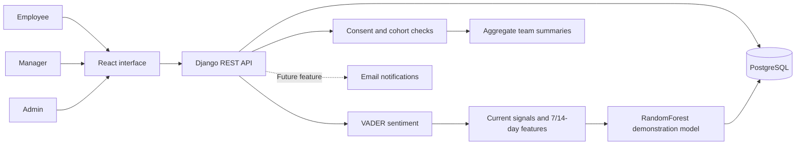

# WellWatch AI

Employee wellness check-ins, personal trends, and consent-based team insights. Built with React, Django REST Framework, and PostgreSQL, using the existing violet/slate interface.

## Features

| Employees | Managers | Admin |
| --- | --- | --- |
| Daily mood, stress, energy, and sleep check-ins | Team naming and employee account management | Platform-wide stats overview |
| Personal trends, history, and CSV reports | Aggregate team insights and CSV reports | User management (create, edit role, activate/deactivate, delete) |
| Recommendations and wellness resources | HR notification UI marked as a future feature | Password reset for any account |
| Consent controls for team summaries | Small-cohort privacy protection | Team management (create teams, assign managers, delete) |
| Profile settings and authenticated password changes | Profile settings and authenticated password changes | Risk distribution across all users |

Individual check-ins and comments are not exposed in team reports. Groups and daily trend points with fewer than three contributors are suppressed.

> **Model status:** scores come from synthetic, rule-labeled training data. They are experimental estimates, not clinically validated predictions or diagnoses.

## Architecture



Vite proxies `/api` to Django during local development. SMTP, Docker, and public hosting are deferred; none is required to run or review the project.

## Admin panel

WellWatch AI includes an admin panel accessible by accounts with the `admin` role.

### Create the first admin account

```bash
# Activate your virtual environment first
source .venv/bin/activate        # macOS / Linux
# .venv\Scripts\activate         # Windows

python backend/manage.py shell -c "
from wellness.models import User
User.objects.create_user(
    username='admin',
    email='admin@wellwatch.local',
    password='Admin@123',
    role='admin',
)
"
```

### Admin modules

| Module | Route | Capability |
| --- | --- | --- |
| Overview | `/admin-dashboard` | Total users, active users (7 days), check-ins (30 days), risk distribution, teams count |
| User Management | `/admin-users` | Create users, change roles, activate/deactivate, reset passwords, delete accounts |
| Team Management | `/admin-teams` | Create teams with assigned manager, view member counts, delete teams |

Log in at the app login page by selecting **Admin** from the role dropdown.

---

## Run locally on macOS

Requires Node 24+, Python 3.11, `uv`, and PostgreSQL 17+ (Homebrew). Install with:

```bash
brew install node@24 python@3.11 postgresql@18
curl -LsSf https://astral.sh/uv/install.sh | sh
brew services start postgresql@18
```

Create the database:

```bash
psql postgres -c "CREATE USER wellwatch WITH PASSWORD 'wellwatch123';"
psql postgres -c "CREATE DATABASE wellwatch OWNER wellwatch;"
```

Copy `.env.example` to `.env` and set `POSTGRES_PORT=5432` (Homebrew default). Then:

```bash
uv venv --python 3.11 && source .venv/bin/activate
uv pip install -r backend/requirements.txt
python backend/manage.py migrate
python backend/manage.py seed_demo
python backend/manage.py train_risk_model --seed 42
npm install
```

Run in two separate terminals:

```bash
# Terminal 1 — backend
source .venv/bin/activate && python backend/manage.py runserver

# Terminal 2 — frontend
npm run dev
```

Open [localhost:5173](http://localhost:5173). Demo credentials are in `.local/demo-accounts.json`.

### Demo account passwords (macOS quick-start)

After running `seed_demo`, reset all demo passwords to something memorable:

```bash
source .venv/bin/activate
python backend/manage.py shell -c "
from wellness.models import User
managers = ['demo.ishaan@example.test', 'demo.neha@example.test']
employees = [u.email for u in User.objects.filter(role='employee')]
for email in managers:
    u = User.objects.get(email=email); u.set_password('Manager@123'); u.save()
for email in employees:
    u = User.objects.get(email=email); u.set_password('Employee@123'); u.save()
print('Done')
"
```

| Role | Email pattern | Password |
| --- | --- | --- |
| Manager | demo.ishaan@example.test, demo.neha@example.test | `Manager@123` |
| Employee | demo.aarav@example.test … demo.sana@example.test | `Employee@123` |
| Admin | admin@wellwatch.local | `Admin@123` |

---

## Run locally on Windows

Use Node 24+ and uv on Windows. uv provisions Python 3.11 if needed. The setup script generates private local credentials when `.env` is absent. Alternatively, copy `.env.example` to `.env` first and replace its placeholder password and Django secret. Do not commit `.env`.

```powershell
./setup-local.ps1
./run-local.ps1
```

Open [localhost:5173](http://localhost:5173). Setup downloads pinned PostgreSQL 17.11 Windows binaries from EDB, verifies the archive checksum, and creates an isolated cluster under ignored `.local/`. No system PostgreSQL installation or Docker is required for this path.

`run-local.ps1` applies migrations, trains the demonstration model if missing, and starts Django and Vite. Keep ports 5173 and 8000 free before launching. An explicit `DATABASE_URL` takes precedence over the `POSTGRES_*` settings.

| Local service | Address |
| --- | --- |
| Frontend | [localhost:5173](http://localhost:5173) |
| API | `127.0.0.1:8000/api` |
| PostgreSQL | `127.0.0.1:55432` |
| Demo login file | `.local/demo-accounts.json` |

### Fictional demo accounts

Setup creates two teams with fictional Indian employees and managers, with varied synthetic check-ins over the preceding four weeks. Each account receives a unique randomly generated password. Find the email, role, and password in ignored `.local/demo-accounts.json`; do not upload or share that file publicly. Choose a manager or employee email from that file to explore both experiences.

The seed command is idempotent: it preserves existing passwords and check-ins and does not replace unrelated user accounts. Run it again with:

```powershell
.venv/Scripts/python.exe backend/manage.py seed_demo
```

Names and wellness histories are fictional demonstration data, not real people or medical records. Private demo data, credentials, model files, and database backups remain outside Git. Role permissions come from the account stored in the database, not the login selector.

### Email features are deferred

HR notification and email password recovery controls are disabled and marked as future features. The backend also rejects delivery requests while these features are deferred. Authenticated password changes remain available in Settings. For a forgotten local account password, a trusted project administrator can use Django's `changepassword` command.

## Project map

```text
src/components/           Login, check-ins, dashboards, reports, insights, settings, admin panel
src/api.js                API requests and authentication errors
src/reports.js            CSV export helpers
backend/config/           Django settings and root routes
backend/wellness/         Models, API, permissions, scoring, migrations, tests
scripts/                  PostgreSQL setup, start, stop, and backups
compose.yaml              PostgreSQL, Django, Nginx, and Mailpit
.github/workflows/        Frontend and PostgreSQL-backed API checks
```

## Deferred deployment work

SMTP delivery, Docker execution, and public hosting are outside the current local release. Existing container configuration is retained for future work and is not required for teammate setup. No email provider, Docker installation, domain, or hosting account is needed.

## Wellness risk model

```powershell
.venv/Scripts/python.exe backend/manage.py train_risk_model --seed 42
```

`train_risk_model` saves an ignored, trusted local `backend/wellness/risk_model.pkl`. It trains a real RandomForestClassifier on reproducible synthetic, rule-labeled data. This is a demonstration, not a clinically validated prediction model. It includes current signals, 7/14-calendar-day averages, prior-week comparisons, streaks, and feature-importance-ranked signal explanations. Without the artifact, scoring falls back to deterministic rules. Restart the API after training. Never load downloaded or user-supplied pickle files. Real deployment needs consented labeled data and independent model evaluation.

## Checks

Start the local database before backend checks. The API suite covers authentication, validation, duplicate prevention, streaks, consent withdrawal, cohort suppression, reports, account updates, password recovery, and model training/loading. Frontend checks cover CSV escaping and stale-token handling.

```powershell
./scripts/start-postgres.ps1
node --test src/*.test.js
npm run lint
npm run build
npm audit --audit-level=high
.venv/Scripts/python.exe backend/manage.py test wellness
.venv/Scripts/python.exe backend/manage.py makemigrations --check --dry-run
```

GitHub Actions runs frontend checks and backend tests against PostgreSQL 17. Source commits are GPG-signed; the setup scripts never push changes.

The isolated local database role has `CREATEDB` so Django can create its test database. For hosted production, use separate migration/test credentials and a restricted runtime role.

## Local database backups

```powershell
./scripts/backup-postgres.ps1
./scripts/stop-postgres.ps1
```

Run `./scripts/backup-postgres.ps1` to save a custom-format dump under ignored `.local/backups/`. Use `pg_restore` against a separate empty database to verify a backup before relying on it. `./scripts/stop-postgres.ps1` stops only this project database. The original SQLite review database is retained unchanged.

The portable PostgreSQL database is loopback-only. Its administrator credential is generated separately from the application password and kept in ignored `.local/`. Never commit `.env`, demo login files, backups, or database artifacts.

## Contributing

Run the checks above before opening a pull request. This contribution preserves the original violet/slate design and adds local setup, sample data, tested APIs, and complete employee/manager screens. Real-world evaluation of the synthetic model and any hosted deployment remain future work.
