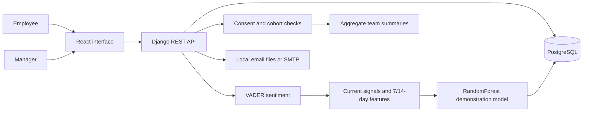

# WellWatch AI

Employee wellness check-ins, personal trends, and consent-based team insights. Built with React, Django REST Framework, and PostgreSQL, using the existing violet/slate interface.

## Features

| Employees | Managers |
| --- | --- |
| Daily mood, stress, energy, and sleep check-ins | Team naming and employee account management |
| Personal trends, history, and CSV reports | Aggregate team insights and CSV reports |
| Recommendations and wellness resources | HR wellness notification emails |
| Consent controls for team summaries | Small-cohort privacy protection |
| Profile settings and password recovery | Profile settings and password recovery |

Individual check-ins and comments are not exposed in team reports. Groups and daily trend points with fewer than three contributors are suppressed.

> **Model status:** scores come from synthetic, rule-labeled training data. They are experimental estimates, not clinically validated predictions or diagnoses.

## Architecture



Vite proxies `/api` to Django during development. In the container stack, Nginx serves the built frontend and proxies `/api` to Waitress.

## Run locally on Windows

Use Node 24+, Python 3.11, and uv. The setup script generates private local credentials when `.env` is absent. Alternatively, copy `.env.example` to `.env` first and replace its placeholder password and Django secret. Do not commit `.env`.

```powershell
npm ci
uv venv .venv --python 3.11
uv pip install --python .venv/Scripts/python.exe -r backend/requirements.txt
./scripts/setup-postgres.ps1
./run-local.ps1
```

Open [localhost:5173](http://localhost:5173). Setup downloads pinned PostgreSQL 17.11 Windows binaries from EDB, verifies the archive checksum, and creates an isolated cluster under ignored `.local/`. No system PostgreSQL installation or Docker is required for this path.

`run-local.ps1` applies migrations, trains the demonstration model if missing, and starts Django and Vite. Keep ports 5173 and 8000 free before launching. An explicit `DATABASE_URL` takes precedence over the `POSTGRES_*` settings.

| Local service | Address |
| --- | --- |
| Frontend | [localhost:5173](http://localhost:5173) |
| API | `127.0.0.1:8000/api` |
| PostgreSQL | `127.0.0.1:55432` |
| Review email files | `backend/local-emails/` |

Set `HR_EMAIL` in `.env` before testing HR notifications, then restart Django. Forgot-password messages contain a reset link for the registered account email; `FRONTEND_URL` controls its origin. Local email files are a review inbox, not external delivery. Review accounts are retained in this checkout's private database; no passwords are committed.

Create the first account, then promote it to manager with the Django shell if needed:

```powershell
.venv/Scripts/python.exe backend/manage.py createsuperuser
.venv/Scripts/python.exe backend/manage.py shell
```

```python
from wellness.models import User
User.objects.filter(username="your-user").update(role="manager")
```

Log in with the account's email and password. Managers can create employee accounts through Settings or the team dashboard. Permissions come from the account's stored role, not the role selected on the login form.

## Project map

```text
src/components/           Login, check-ins, dashboards, reports, insights, settings
src/api.js                API requests and authentication errors
src/reports.js            CSV export helpers
backend/config/           Django settings and root routes
backend/wellness/         Models, API, permissions, scoring, migrations, tests
scripts/                  PostgreSQL setup, start, stop, and backups
compose.yaml              PostgreSQL, Django, Nginx, and Mailpit
.github/workflows/        Frontend and PostgreSQL-backed API checks
```

## Docker Compose stack

Docker Compose runs PostgreSQL, Django with Waitress, the Nginx frontend/reverse proxy, and Mailpit as a local SMTP review inbox. Set private values in `.env` before starting; the Compose service requires `POSTGRES_DB`, `POSTGRES_USER`, `POSTGRES_PASSWORD`, and `DJANGO_SECRET_KEY`.

```powershell
docker compose up --build -d
```

Open the app at [127.0.0.1:8080](http://127.0.0.1:8080) and Mailpit at [127.0.0.1:8025](http://127.0.0.1:8025). The database is persistent in the `postgres_data` volume, separate from the portable Windows cluster. Compose migrations run when the backend starts. Mailpit accepts messages for review and does not deliver them externally. To route HR notifications in a real deployment, configure a real SMTP host, port, TLS mode, username, password, sender, and `HR_EMAIL` through the deployment's secret manager; no provider credentials are included here.

Set `FRONTEND_URL=http://localhost:8080` for Compose password-reset links. For the local Compose inbox, use `EMAIL_HOST=mailpit`, `EMAIL_PORT=1025`, `EMAIL_USE_TLS=0`, and a review `HR_EMAIL`. Container execution has not been verified on this machine because Docker is unavailable.

For production, set `DJANGO_DEBUG=0`, replace the Mailpit SMTP settings with a real provider, and provide a random `DJANGO_SECRET_KEY`, allowed host names, SMTP credentials, sender and HR addresses, and the public browser origin in `CORS_ALLOWED_ORIGINS`. Keep the web service behind a TLS terminating reverse proxy and preserve the incoming `X-Forwarded-Proto` header. The published Compose ports bind to loopback so a host proxy can reach them; do not expose PostgreSQL or Mailpit publicly. Back up `postgres_data` and verify restores before upgrading.

## Wellness risk model

```powershell
.venv/Scripts/python.exe backend/manage.py train_risk_model --seed 42
```

`train_risk_model` saves an ignored, trusted local `backend/wellness/risk_model.pkl`. It trains a real RandomForestClassifier on reproducible synthetic, rule-labeled data. This is a demonstration, not a clinically validated prediction model. It includes current signals, 7/14-calendar-day averages, prior-week comparisons, streaks, and feature-importance-ranked signal explanations. Without the artifact, scoring falls back to deterministic rules. Restart the API after training. Never load downloaded or user-supplied pickle files. Real deployment needs consented labeled data and independent model evaluation.

## Checks

Start the local database before backend checks. The API suite covers authentication, validation, duplicate prevention, streaks, consent withdrawal, cohort suppression, reports, account updates, password recovery, and model training/loading. Frontend checks cover CSV escaping and stale-token handling.

```powershell
./scripts/start-postgres.ps1
node --test src/*.test.js
npm run lint
npm run build
npm audit --audit-level=high
.venv/Scripts/python.exe backend/manage.py test wellness
.venv/Scripts/python.exe backend/manage.py makemigrations --check --dry-run
```

GitHub Actions runs frontend checks and backend tests against PostgreSQL 17. Local commits are GPG-signed; nothing is pushed automatically.

The isolated local database role has `CREATEDB` so Django can create its test database. For hosted production, use separate migration/test credentials and a restricted runtime role.

## Local database backups

```powershell
./scripts/backup-postgres.ps1
./scripts/stop-postgres.ps1
```

Run `./scripts/backup-postgres.ps1` to save a custom-format dump under ignored `.local/backups/`. Use `pg_restore` against a separate empty database to verify a backup before relying on it. `./scripts/stop-postgres.ps1` stops only this project database. The original SQLite review database is retained unchanged.

For production HTTPS proxies set `TRUST_PROXY=1` only when the proxy overwrites forwarded headers, `FRONTEND_URL` to the public app origin, and `CSRF_TRUSTED_ORIGINS` to its HTTPS origin. No public hosting account or production SMTP credentials are included. Local notification files and Compose Mailpit provide real delivery to a review inbox without sending externally.
